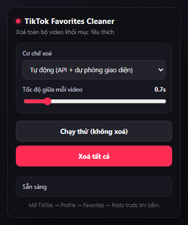
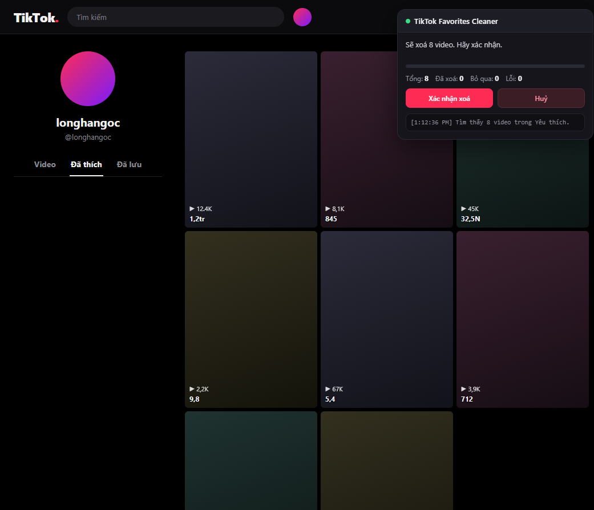
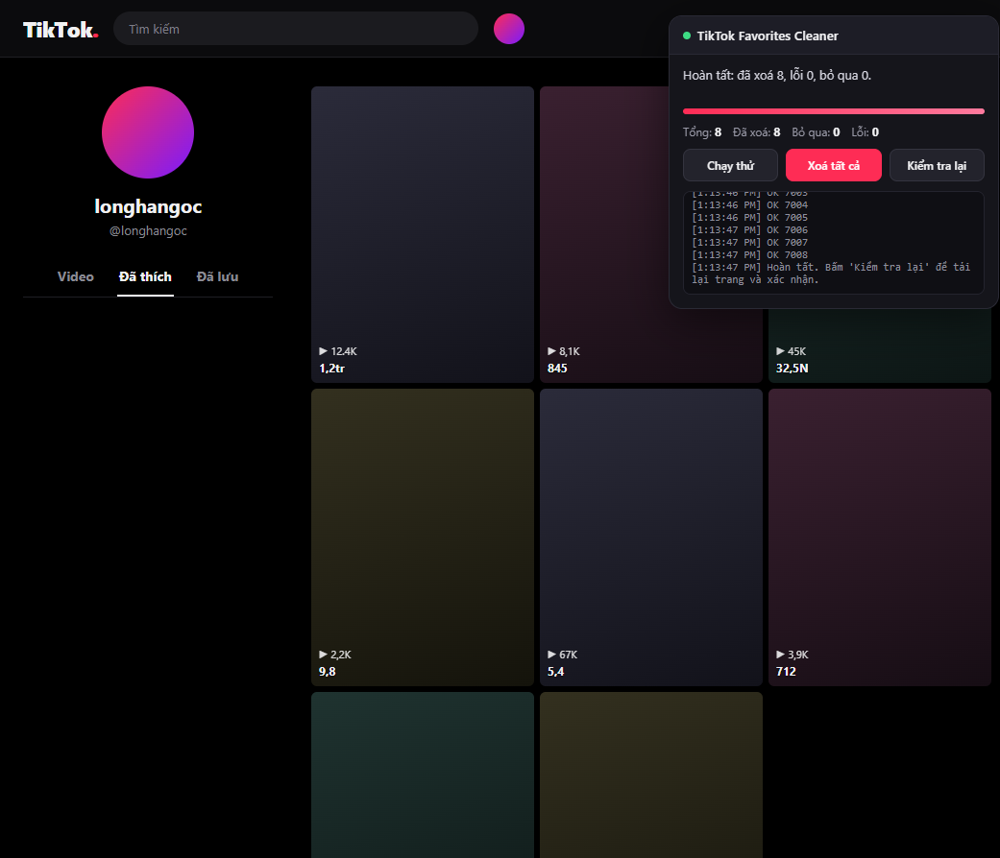

# TikTok Favorites Cleaner

Tiện ích Chrome (Manifest V3) giúp **xoá toàn bộ video khỏi mục Yêu thích (Favorites → Posts)** trên `tiktok.com` một cách tự động.

Có **2 cơ chế xoá** trong cùng một extension:

| Cơ chế | Mô tả | Khi nào dùng |
|---|---|---|
| **API nhanh** | Gọi thẳng endpoint TikTok tự dùng để bỏ yêu thích | Nhanh nhất |
| **Giao diện (UI)** | Mở từng video, bấm đúng icon bookmark vàng | Dự phòng khi API lỗi, hoặc chọn riêng |
| **Tự động** (mặc định) | Thử API trước, lỗi thì chuyển sang giao diện | Khuyến nghị |

## Ảnh chụp màn hình

Ảnh chụp trực tiếp từ giao diện thật của extension (dữ liệu TikTok trong ảnh là minh hoạ).

<table>
  <tr>
    <td align="center">
      
      <br /><b>Popup điều khiển</b>
    </td>
    <td align="center">
      
      <br /><b>Panel tiến độ — bước xác nhận</b>
    </td>
  </tr>
</table>

<p align="center">
  
  <br /><b>Panel sau khi xoá xong — nút “Kiểm tra lại”</b>
</p>

## Tính năng

- Liệt kê toàn bộ video trong **Favorites → Posts** (tự cuộn để tải hết).
- **Chạy thử (dry-run)**: chỉ đếm, không xoá gì.
- **Xác nhận** trước khi xoá thật — không bao giờ xoá khi chưa có xác nhận.
- **Tạm dừng / Dừng** bất cứ lúc nào, kể cả lúc đang chờ xác nhận.
- Tự thử lại 3 lần khi lỗi mạng, tự dừng khi TikTok chặn (429 / 401 / 403) hoặc sau 5 lỗi liên tiếp.
- Panel tiến độ ngay trên trang + nút **Kiểm tra lại** (tải lại và đếm lại).
- Không gửi dữ liệu ra ngoài, không analytics.

## Cài đặt

1. Tải/giải nén thư mục này vào một chỗ cố định (ví dụ `D:\tiktok remove`).
2. Mở Chrome, vào `chrome://extensions`.
3. Bật **Developer mode** (góc trên bên phải).
4. Bấm **Load unpacked** → chọn thư mục chứa `manifest.json`.
5. Ghim extension vào thanh công cụ cho tiện.

## Sử dụng

1. Mở `https://www.tiktok.com`, **đăng nhập**.
2. Vào **Profile → Favorites → Posts** (mục Yêu thích).
3. Bấm icon extension.
4. Chọn cơ chế xoá và tốc độ (mặc định 0.7s/video).
5. Bấm **Chạy thử** trước để xem sẽ xoá bao nhiêu video.
6. Nếu ổn, bấm **Xoá tất cả** → panel hiện ra → bấm **Xác nhận xoá**.
7. Chờ chạy xong. Bấm **Kiểm tra lại** để tải lại trang và xác nhận số video còn lại.

> Mẹo: nếu gặp lỗi "Không kết nối được với trang", extension sẽ tự thử inject lại — nếu vẫn lỗi, hãy tải lại tab TikTok.

## Chạy test

Các test dùng [jsdom](https://github.com/jsdom/jsdom) để chạy `content.js` trong DOM giả (không cần Chrome thật).

```powershell
npm install --no-save jsdom
node tests/run-all.cjs
```

Hoặc chạy riêng:

```powershell
node tests/background.test.cjs    # 12 test: endpoint, header, rate limit, session...
node tests/smoke-content.test.cjs # panel Shadow DOM, dry-run, getStatus
node tests/remove-flow.test.cjs   # không xoá khi chưa xác nhận, xoá đủ, Dừng, chạy lại
node tests/ui-flow.test.cjs       # cơ chế UI, auto fallback, 5 lỗi liên tiếp
node tests/recovery-flow.test.cjs # tự chạy lại sau điều hướng, Kiểm tra lại, không tự xoá
```

## Cấu trúc

```
manifest.json     # cấu hình MV3
background.js     # service worker — gọi API unfavorite trong MAIN world
content.js        # logic liệt kê + UI + panel + vòng lặp
popup.html/css/js # điều khiển nhanh
icons/            # icon 16/48/128
screenshots/      # ảnh chụp popup + panel dùng cho README
tests/            # bộ test tự động (28 test)
docs/superpowers/specs/2026-11-18-tiktok-favorites-cleaner-design.md
```

## Cách hoạt động (tóm tắt)

**API:** `POST https://www.tiktok.com/api/item/collect/?aid=1988&action=2&itemId=<id>&secUid=<secUid>`
- `action=2` = bỏ yêu thích (đối chiếu với extension gốc `gabireze/tiktok-all-favorite-videos-remover`).
- `secUid` + `csrfToken` đọc từ `window.__$UNIVERSAL_DATA$__` (fallback `#__UNIVERSAL_DATA_FOR_REHYDRATION__`).
- Gọi trong MAIN world qua `chrome.scripting.executeScript` để có cookie + context thật.

**UI:** mở card → tìm nút `[data-e2e="bookmark-icon"]` (hoặc `collect-icon`, `favorites-icon`, `browse-bookmark`, aria-label) → kiểm tra trạng thái → bấm → xác minh trạng thái đổi → đóng modal.

## Lưu ý & giới hạn

- TikTok có thể thay đổi giao diện/endpoint bất cứ lúc nào. Nếu API lỗi, hãy chọn cơ chế **Giao diện**.
- Nếu bị chặn tạm thời (rate limit), chờ khoảng 1 giờ rồi chạy lại.
- Extension chỉ chạy trên `tiktok.com` và chỉ tác động lên tài khoản đang đăng nhập.
- Việc xoá yêu thích **không thể hoàn tác** bằng extension này — hãy chạy thử trước.
- Cơ chế UI giả định bấm card sẽ mở **modal** (không điều hướng cả trang). Nếu TikTok đổi sang điều hướng, panel sẽ mất; extension sẽ báo lại ở lần mở sau chứ **không tự động xoá tiếp**.

## Quyền sử dụng

Extension chỉ dùng các quyền tối thiểu: `storage`, `scripting`, `tabs` và quyền truy cập `https://www.tiktok.com/*`.